### Timothé Cagin

Ingénieur Icam (2026), **IA appliquée : agents, LLM, RAG, automatisation**. Je construis des agents qui tournent en production, dont on connaît le coût, les droits et le responsable.

Je cherche un poste en CDI à Paris, en équipe de déploiement d'agents IA ou d'ingénierie IA appliquée.
[LinkedIn](https://www.linkedin.com/in/timoth%C3%A9-cagin-61a711225/)

---

#### Ce que j'apporte à une équipe

| Ce que votre client ou votre équipe demande | Ce que j'ai déjà fait |
|---|---|
| Un agent utile, pas une démo | Pour un fabricant québécois, une chaîne qui lit des appels d'offres de 360 pages (environ 8 heures de lecture manuelle) et alimente quatre applications Microsoft 365. 187 tests automatisés. Validation humaine là où elle compte |
| Un coût maîtrisé | Un routeur unique : le modèle local d'abord, le cloud seulement sur un échec mesuré. Un banc d'essai choisit le modèle de chaque tâche |
| Un agent qui ne fait pas n'importe quoi | Un garde qui bloque les commandes destructrices, un sas d'entrée pour tout logiciel tiers, aucun secret dans un livrable, tout geste irréversible laissé à un humain |
| Une preuve que ça marche | Des sondes qui savent échouer, un journal daté de chaque étape, des décisions tracées avec leur option par défaut |

#### Du besoin à l'adoption : ma façon de travailler

```mermaid
flowchart LR
    B["Besoin métier<br/>cas d'usage, ROI attendu"] --> D["Données<br/>connexions, droits, périmètre"]
    D --> A["Agent borné<br/>outils, garde-fous,<br/>validation humaine"]
    A --> M["Mesure<br/>coût, qualité, adoption"]
    M -->|écart| A
    M --> F["Formation<br/>des utilisateurs référents"]

    style A fill:#1a2b26,stroke:#6d9083
    style M fill:#2d2416,stroke:#b7986a
```

Trois questions guident chaque agent : **ce qu'il voit, ce qu'il a le droit de faire, et qui valide.**

---

#### Mon environnement de travail

Je fais tourner chaque jour mon propre écosystème d'agents : une station GPU locale, un serveur en point d'entrée, des machines reliées par un réseau privé, six IA qui ont chacune un rôle écrit. Celle qui écrit n'est jamais celle qui juge.

```mermaid
flowchart TB
    T["Moi : intention, décisions,<br/>gestes irréversibles"]
    P["Pilote<br/>planifie, découpe, vérifie"]
    J["Juge<br/>critique, relit"]
    E["Exécutant<br/>code en copie jetable"]
    O["Second avis<br/>autre fournisseur"]
    L["Modèles locaux<br/>tri, extraction, données privées"]

    T --> P
    P -->|brief écrit| E
    P -->|question ouverte| O
    P -->|lot de nuit| L
    E -->|résultat et preuves| J
    O --> J
    L --> J
    J -->|verdict| P
    P -->|décision à prendre| T

    style T fill:#1a2b26,stroke:#6d9083
    style J fill:#2d2416,stroke:#b7986a
```

| Moteur | Rôle | Ce qu'il ne fait pas |
|---|---|---|
| Claude Opus | Pilote : cadrage, découpage, relecture | Le code mécanique qu'un exécutant peut faire |
| Claude Fable | Juge : enquête, contre-expertise | Le code de production |
| Codex | Exécutant : missions bornées en copie jetable, tests | Décider, publier, toucher un service en production |
| Gemini | Second avis : multimodal, recherche longue | Modifier sans brief écrit |
| Qwen et Gemma, en local | Tri, classement, extraction, embeddings | Rendre seuls un verdict final |
| Hermes | Messagerie : résumé du jour, alertes, décisions | Traiter de gros volumes |

#### Les vitrines

| Dépôt | Ce qu'il montre |
|---|---|
| [MoltBot Hub](https://github.com/TimoLeDozo/MoltBot-Hub) | Un rôle par moteur, l'échelle de repli local puis cloud, un titulaire par capacité choisi au banc, une porte humaine sur l'irréversible |
| [Infrastructure](https://github.com/TimoLeDozo/Infrastructure) | <!-- mesure:outils -->633<!-- /mesure --> outils indexés, <!-- mesure:sondes -->113<!-- /mesure --> sondes qui savent échouer, un sas pour tout logiciel tiers, une note sur 20 pour chaque module |

Les dépôts exploités restent privés. Les vitrines publient une méthode, jamais une topologie. Chacune a son journal daté, dernier relevé le <!-- mesure:maj -->10/11/2026<!-- /mesure -->.

#### Ce qui me guide

1. Un agent utile est outillé **et** borné.
2. Une sonde qui ne peut pas échouer ne prouve rien.
3. Un remplaçant remplace, il ne s'ajoute pas.
4. Celui qui écrit n'est pas celui qui juge.

---

#### In English

Icam engineer (2026) in **applied AI: agents, LLMs, RAG, automation**. I build agents that run in production, with a known cost, known permissions and a named owner. Looking for a permanent role in Paris on an AI deployment or applied AI engineering team.

- **A useful agent, not a demo.** For a Quebec manufacturer: a pipeline that reads 360-page tenders (about 8 hours of manual review) and feeds four Microsoft 365 applications, 187 automated tests, human validation where it matters.
- **Controlled cost.** One router: local model first, cloud only after a measured failure.
- **Safe by design.** Destructive-command guard, intake gate for third-party software, no secret in any deliverable, irreversible actions stay human.
- **Proof it works.** Health probes that can fail, a dated log, traced decisions.

Diagrams of the architecture are in the two showcase repositories above.

[LinkedIn](https://www.linkedin.com/in/timoth%C3%A9-cagin-61a711225/) · Consulting activity: [icarus-ia.fr](https://icarus-ia.fr)
