### Timothé Cagin

Ingénieur ICAM. Je fonde **[ICARUS-IA](https://icarus-ia.fr)** : automatiser les flux documentaires des PME industrielles, avec des agents qu'on peut contrôler, mesurer et arrêter.

Pour y arriver, je fais tourner chaque jour mon propre écosystème d'agents. Plusieurs modèles, des centaines d'outils, une station GPU locale, et une règle : rien ne change sans une mesure avant et après.

```mermaid
flowchart LR
    I["Infrastructure<br/>outils tenus, mesurés, notés"] --> H["MoltBot Hub<br/>modèles et agents gouvernés"]
    H --> C["ICARUS-IA<br/>flux documentaires des PME"]
    C -.retours terrain.-> I

    style C fill:#1a2b26,stroke:#6d9083
```

#### Les IA de l'écosystème

| IA | Rôle | Ce qu'elle ne fait pas |
|---|---|---|
| Claude Opus 5.5 | Pilote : cadrage, découpage, relecture, livrables clients | Le code mécanique qu'un exécutant peut faire |
| Claude Fable 5.1 | Juge : enquête, contre-expertise, relecture critique des sessions | Le code de production |
| Codex | Exécutant : missions bornées en atelier jetable, correctifs, tests, travail de nuit | Décider, publier, toucher un service en production |
| Gemini, via Antigravity | Second avis : multimodal, recherche longue, relecture lourde | Modifier sans brief écrit |
| Qwen et Gemma, en local | Tri, classement, extraction, embeddings, données privées | Rendre seuls un verdict final |
| Hermes | Agent de messagerie : résumé du jour, état, décisions, alertes | Traiter de gros volumes |

#### Les vitrines

| Dépôt | Ce qu'il montre |
|---|---|
| [Infrastructure](https://github.com/TimoLeDozo/Infrastructure) | 607 outils indexés, 102 sondes qui savent échouer, un sas pour tout logiciel tiers, une note sur 20 pour chaque module |
| [MoltBot Hub](https://github.com/TimoLeDozo/MoltBot-Hub) | Un rôle par moteur, l'échelle de repli local puis cloud, un titulaire par capacité gagné au banc, une porte humaine sur l'irréversible |

Chaque vitrine a son [journal daté](https://github.com/TimoLeDozo/Infrastructure/blob/main/JOURNAL.md). Les dépôts exploités restent privés. Les vitrines publient une capacité, jamais une topologie.

#### Ce qui me guide

1. Un agent utile est outillé **et** borné.
2. Une sonde qui ne peut pas échouer ne prouve rien.
3. Un remplaçant remplace, il ne s'ajoute pas.
4. Celui qui écrit n'est pas celui qui juge.

#### Ce que je vise

- Un banc reproductible sur données synthétiques, pour que mes notes soient vérifiables de l'extérieur.
- Un premier client industriel servi par cette chaîne, du document entrant à l'action validée.
- Moins d'outils pour plus de résultats.

[icarus-ia.fr](https://icarus-ia.fr) · [LinkedIn](https://www.linkedin.com/in/timoth%C3%A9-cagin-61a711225/)
